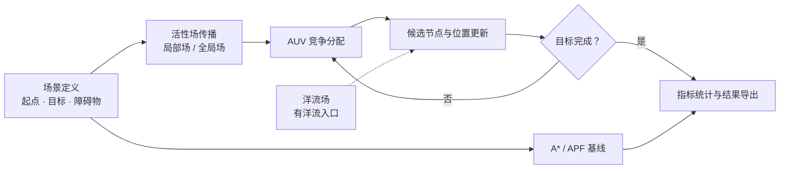

<a id="top"></a>

<p align="center">
  
</p>

<h1 align="center">多 AUV 任务分配与路径规划</h1>

<p align="center">
  基于 GBSOM 的多航行器协同规划 · 三维栅格环境 · 洋流影响分析
</p>

<p align="center">
  <a href="#quick-start"><strong>快速开始</strong></a> ·
  <a href="#gallery"><strong>实验展示</strong></a> ·
  <a href="#architecture"><strong>算法流程</strong></a> ·
  <a href="docs/EXPERIMENTS.md"><strong>复现说明</strong></a>
</p>

<p align="center">
  
  
  
  
  
</p>

---

<a id="overview"></a>

## 🌊 项目概览

在复杂水下环境中，多台自主水下航行器（AUV）需要协同分配任务，并在避开障碍物的同时完成多个目标的访问。本项目将神经网络活性场与自组织映射结合，研究任务分配、路径生成和航行代价之间的关系。

代码覆盖从二维场景到三维空间的扩展，提供无洋流与有洋流实验入口，以及 A*、人工势场法（APF）的对比实现。

| 默认三维空间 | AUV 数量 | 目标数量 | 规划方法 |
| :---: | :---: | :---: | :---: |
| **25 × 25 × 25** | **5** | **6** | **GBSOM / A\* / APF** |

### ✨ 核心能力

| | 能力 | 实现内容 |
| :--- | :--- | :--- |
| 🎯 | **协同任务分配** | 活性场传播、AUV 竞争分配与多任务关系处理 |
| 🧭 | **三维路径规划** | 26 邻域栅格、立体障碍物与不同高度的目标 |
| 🌊 | **洋流影响建模** | 分层剪切流、中央射流、垂向扰动及位置漂移 |
| ⚖️ | **多算法对比** | GBSOM、A*、APF 的路径与任务完成情况统计 |
| 🔋 | **航程与能耗分析** | 累计航程、等效能耗与过程曲线 |
| 📁 | **实验图表导出** | 路径图、流场图、障碍物三视图及 CSV 数据 |

<a id="gallery"></a>

## 🖼️ 实验展示

<table>
  <tr>
    <th width="50%">多 AUV 三维路径</th>
    <th width="50%">三维洋流场</th>
  </tr>
  <tr>
    <td></td>
    <td></td>
  </tr>
  <tr>
    <td align="center"><sub>任务分配与路径生成</sub></td>
    <td align="center"><sub>流速方向与空间分布</sub></td>
  </tr>
</table>

> 图表为仓库内保留的实验示例，横幅为示意图。不同版本的图片、数据与默认参数不一定来自同一次运行，复现实验时请核对参数与数据来源。

<a id="quick-start"></a>

## 🚀 快速开始

### 1 · 准备环境

使用支持脚本局部函数、`table`、`writetable` 和三维绘图的 **MATLAB**。主仿真不需要 Python、数据库或外部服务。

<details>
<summary><strong>版本、字体与兼容性说明</strong></summary>

- 项目未锁定最低 MATLAB 版本或完整工具箱版本。
- GNU Octave 兼容性尚未验证。
- 部分图形使用微软雅黑等中文字体，缺失时可能影响标注显示。
- 活性传播包含多层循环，运行耗时与机器配置、栅格规模和扩散次数有关。

</details>

### 2 · 获取项目

```bash
git clone https://github.com/Pluto-Liu-github/multi-auv-path-planning.git
cd multi-auv-path-planning
```

在 MATLAB 中打开项目，将根目录设为当前文件夹。私有仓库需要使用有访问权限的 GitHub 账户克隆。

### 3 · 选择实验

<table>
  <tr>
    <th width="50%">三维 · 无洋流</th>
    <th width="50%">三维 · 有洋流</th>
  </tr>
  <tr>
    <td>GBSOM 规划、A* / APF 对比与结果导出</td>
    <td>增加流场采样、位置漂移与洋流能耗估计</td>
  </tr>
  <tr>
    <td><code>run_main</code></td>
    <td><code>run_main_current</code></td>
  </tr>
</table>

首次运行无洋流实验，在 MATLAB 命令窗口执行：

```matlab
% Run from the project root.
if ~exist(fullfile(pwd, 'paper-output', 'figures'), 'dir')
    mkdir(fullfile(pwd, 'paper-output', 'figures'));
end
run_main
```

运行有洋流实验：

```matlab
run_main_current
```

> [!NOTE]
> 两个入口都会清空工作区、关闭图窗并覆盖同名输出。需要保留实验对比时，先保存参数和结果副本。

<details>
<summary><strong>运行后查看哪些变量？</strong></summary>

```matlab
comparison_table       % Comparison metrics
robot_energy_total     % Cumulative energy per AUV
robot_dist_total       % Cumulative distance per AUV
energy_history         % Energy history
dist_history           % Distance history
```

无洋流入口还提供 `baseline_task_pairs`，每行为 `[AUV 编号, 目标编号]`。

</details>

<details>
<summary><strong>如何运行二维场景？</strong></summary>

在独立 MATLAB 会话中进入对应目录，执行其中的 `mainin.m`：

| 目录 | 场景 |
| --- | --- |
| `matlab/original_2d/one_to_one/` | 单 AUV、单目标 |
| `matlab/original_2d/one_to_many_tft/` | 单 AUV、多目标 |
| `matlab/original_2d/many_to_many/` | 多 AUV、多目标 |

二维和三维代码有同名函数，**不要使用 `addpath(genpath(pwd))` 将整个项目加入路径**。遇到参数数量或维度错误，先检查：

```matlab
which mainin -all
which weight_wij -all
which Pn -all
```

</details>

<a id="architecture"></a>

## 🧠 算法流程



主循环负责任务推进；洋流入口在路径更新中加入流场影响。两个入口的基线任务分配与能耗口径存在差异，详见 [实验与复现说明](docs/EXPERIMENTS.md)。

### 🗂️ 代码导航

| 模块 | 职责 |
| --- | --- |
| [`matlab/core/`](matlab/core/) | 活性场、竞争分配、候选节点与权值更新 |
| [`matlab/current/`](matlab/current/) | 流场生成、速度采样、漂移与洋流能耗 |
| [`matlab/baselines/`](matlab/baselines/) | A*、APF 及基线任务序列执行 |
| [`matlab/utils/`](matlab/utils/) | 栅格构建、邻域判断与路径统计 |
| [`matlab/visualization/`](matlab/visualization/) | 三维路径与实验指标绘图 |
| [`matlab/original_2d/`](matlab/original_2d/) | 三套二维任务场景 |

<details>
<summary><strong>展开项目目录</strong></summary>

```text
.
├── run_main.m                   # 3D simulation without currents
├── run_main_current.m           # 3D simulation with currents
├── mainin.m                     # Planning, comparison, and export
├── mainin_3d_current.m           # Current-aware simulation
├── startup.m                    # MATLAB path setup
├── matlab/
│   ├── core/                    # GBSOM core
│   ├── current/                 # Ocean-current model
│   ├── baselines/               # A* and APF
│   ├── utils/                   # Grid and path utilities
│   ├── visualization/           # Figure export
│   ├── original_2d/             # 2D scenarios
│   └── tmp_2d_*/                # 2D analysis variants
├── chapter4_figures/            # No-current example figures
├── current_figures/             # Current-aware example figures
├── comparison_current_figures/  # Baseline comparison figures
├── paper-output/figures/        # Input data and generated outputs
├── generate_*.m                 # Analysis and plotting scripts
└── docs/
    ├── assets/                 # README visual assets
    └── EXPERIMENTS.md           # Reproducibility notes
```

论文正文、教师批注、答辩文件和本地工作记录不包含在此代码仓库中。

</details>

<a id="outputs"></a>

## 📦 实验输出

| 实验 | 图形输出 | 数据输出 |
| --- | --- | --- |
| **三维无洋流** | `chapter4_figures/` 与 `paper-output/figures/` | 指标 CSV、任务配对 CSV、工作区变量 |
| **三维有洋流** | `current_figures/` 与 `comparison_current_figures/` | 工作区指标表与过程变量，不自动导出指标 CSV |
| **二维分析** | `paper-output/figures/` | 使用已有 MAT 输入生成汇总 CSV 与图表 |

绘制环境、障碍物三视图或进行二维能耗分析，可查看根目录的 `generate_*.m` 脚本。各脚本所需的数据文件列在 [辅助绘图与数据说明](docs/EXPERIMENTS.md#辅助绘图与数据) 中。

<a id="reproducibility"></a>

## 🔬 复现须知

> [!IMPORTANT]
> 有／无洋流入口的默认扩散步数和目标到达阈值不同；有洋流入口的 A*、APF 基线没有使用相同洋流能耗模型。直接运行两个入口，不能视为仅改变洋流条件的严格消融实验。

- **参数直接写在脚本中**：修改地图、任务与流场时，需同步核对制图脚本和输入数据。
- **统计口径需要对齐**：`SearchSteps` 在不同算法中含义不同，等效能耗不等于实测电能。
- **当前洋流配置**：`current_guidance_gain = 0` 关闭顺流节点评分奖励，位置漂移和洋流能耗仍启用。
- **验证状态**：已做文件与源码静态核对，未在本次文档整理中重跑 MATLAB；当前没有自动化测试或持续集成。

完整的参数表、任务配对规则与指标解释见 **[EXPERIMENTS.md](docs/EXPERIMENTS.md)**。

<a id="feedback"></a>

## 💬 问题反馈

遇到运行问题，可在 [Issues](https://github.com/Pluto-Liu-github/multi-auv-path-planning/issues) 中提供 MATLAB 版本、运行入口、修改过的参数和完整错误信息。复现实验差异时，请同时注明使用的 MAT 数据和图表来源。

## 📄 许可

如需转载、分发或用于其他项目，请先联系 [仓库作者](https://github.com/Pluto-Liu-github) 确认授权。

---

<p align="center">
  <sub>Multi-AUV Task Allocation &amp; Path Planning</sub><br>
  <a href="#top">返回顶部 ↑</a>
</p>
