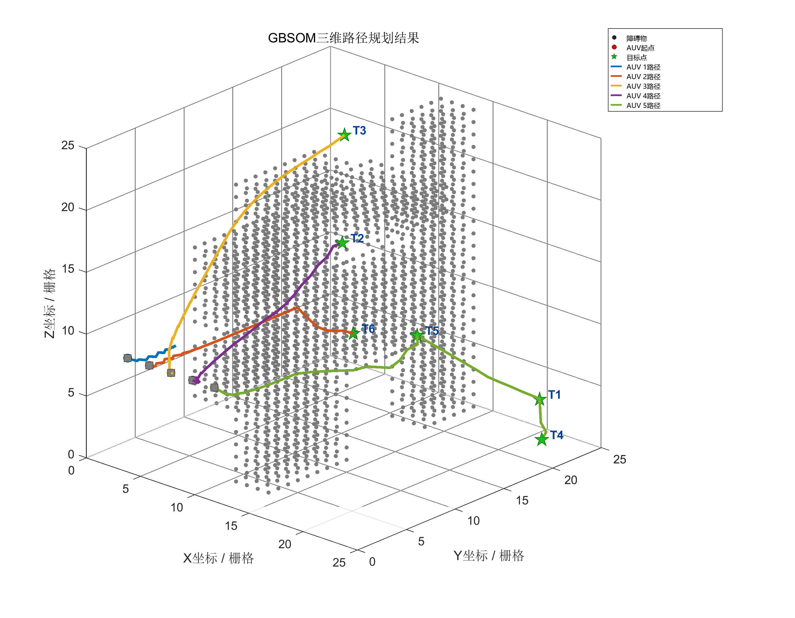
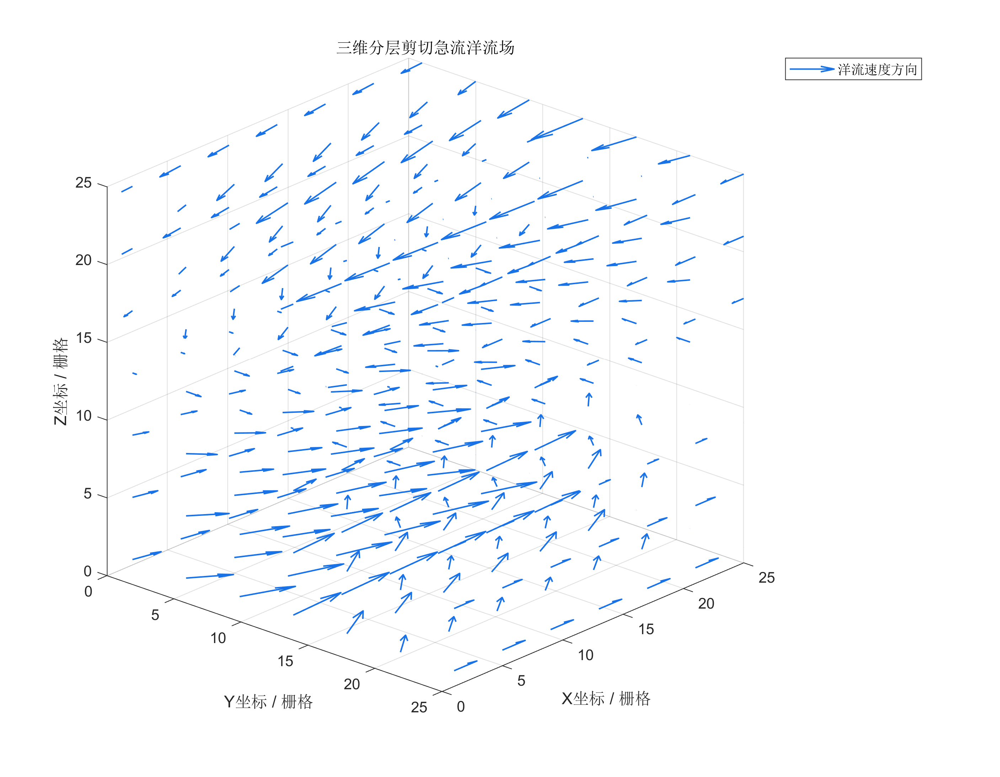

# 多 AUV 任务分配与路径规划

**Multi-AUV Task Allocation and Path Planning · MATLAB**

面向多自主水下航行器（AUV）的任务分配与路径规划研究项目。以神经网络活性场与自组织映射结合的 GBSOM 方法为核心，包含二维任务场景、三维栅格扩展、洋流影响建模，以及 A* 和人工势场法（APF）对比实现。

默认三维场景在 **25 × 25 × 25** 栅格空间中，使用 **5 个 AUV** 完成 **6 个目标**的访问任务。



*已有实验图，用于展示场景与路径；不同版本的图片、数据和默认参数不一定来自同一次运行。*

## 功能

- **多机多目标规划**：活性场传播、AUV 竞争分配、任务关系处理与路径更新。
- **三维环境建模**：26 邻域栅格、立体障碍物和不同高度的目标。
- **洋流扩展**：分层剪切流、中央射流、弱垂向扰动，以及漂移和等效能耗估计。
- **算法对比**：A*、APF 的路径、成功率、航程、搜索步数与等效能耗统计。
- **实验绘图**：三维路径、累计能耗、累计航程、流场和障碍物三视图。
- **二维场景**：单机单目标、单机多目标、多机多目标及有／无洋流分析副本。

## 快速开始

### 环境

使用支持脚本局部函数、`table`、`writetable` 和三维绘图的 MATLAB。项目未锁定最低 MATLAB 版本或工具箱版本，未验证 GNU Octave 兼容性。部分图形使用微软雅黑等中文字体。

主仿真不需要 Python、数据库或外部服务。

### 1. 获取项目

```bash
git clone https://github.com/Pluto-Liu-github/multi-auv-path-planning.git
cd multi-auv-path-planning
```

在 MATLAB 中打开克隆后的文件夹，并将它设为当前文件夹。私有仓库需要具有访问权限的 GitHub 账户才能克隆。

### 2. 运行三维无洋流实验

```matlab
% 在项目根目录执行
if ~exist(fullfile(pwd, 'paper-output', 'figures'), 'dir')
    mkdir(fullfile(pwd, 'paper-output', 'figures'));
end
run_main
```

入口会加载所需代码目录，运行 GBSOM、A* 和 APF，并导出图表。完成后可在工作区查看：

```matlab
comparison_table       % 算法对比指标
baseline_task_pairs    % [AUV 编号, 目标编号]
robot_energy_total     % 各 AUV 累计等效能耗
robot_dist_total       % 各 AUV 累计航程
energy_history         % 能耗历史
dist_history           % 航程历史
```

### 3. 运行三维有洋流实验

```matlab
run_main_current
```

该入口增加流场采样、漂移和洋流能耗计算。当前顺流节点评分参数 `current_guidance_gain` 为 `0`，但漂移和洋流能耗仍启用。

两个主脚本都会清空工作区、关闭图窗并覆盖同名输出。保留对比实验时，请先保存参数和输出副本。

## 项目结构

```text
.
├── run_main.m                  # 无洋流三维入口
├── run_main_current.m          # 有洋流三维入口
├── mainin.m                    # 无洋流规划、对比与结果导出
├── mainin_3d_current.m          # 有洋流规划与结果导出
├── startup.m                   # 加载三维基础代码路径
├── matlab/
│   ├── core/                   # 活性场、竞争分配与位置更新
│   ├── baselines/              # A*、APF 和任务序列执行
│   ├── utils/                  # 栅格、邻域和路径统计
│   ├── visualization/          # 实验图形导出
│   ├── current/                # 流场、漂移和洋流能耗
│   ├── original_2d/            # 三套二维场景
│   └── tmp_2d_*/               # 保留的二维分析工作副本
├── chapter4_figures/           # 无洋流示例图
├── current_figures/            # 有洋流示例图与流场图
├── comparison_current_figures/ # 有洋流入口的对比示例图
├── paper-output/figures/       # 精选实验数据及生成输出
├── generate_*.m                # 环境、三视图与能耗分析脚本
└── docs/
    └── EXPERIMENTS.md          # 参数、数据与比较口径
```

论文正文、教师批注、答辩文件、排版预览和本地工作记录不包含在此代码仓库中。

## 二维实验

在独立 MATLAB 会话中进入以下目录之一，执行该目录的 `mainin.m`：

| 目录 | 场景 |
| --- | --- |
| `matlab/original_2d/one_to_one/` | 单 AUV、单目标 |
| `matlab/original_2d/one_to_many_tft/` | 单 AUV、多目标 |
| `matlab/original_2d/many_to_many/` | 多 AUV、多目标 |

二维和三维代码含有同名函数，**不要将整个项目用 `addpath(genpath(pwd))` 加入路径**。遇到参数数量或维度错误时，先检查解析到的文件：

```matlab
which mainin -all
which weight_wij -all
which Pn -all
```

## 输出位置

| 入口 | 输出 |
| --- | --- |
| `run_main` | `chapter4_figures/` 中的路径、能耗、航程图；`paper-output/figures/` 中的第 4、5 章图、指标 CSV 和任务配对 CSV |
| `run_main_current` | `current_figures/` 中的路径、能耗、航程及流场图；`comparison_current_figures/` 中的算法对比图 |

有洋流入口的指标表保留在 MATLAB 工作区，当前不自动写出指标 CSV。



## 复现与结果解释

参数直接写在主脚本中。两个三维入口的默认扩散步数、目标到达阈值不完全一致；有洋流入口的 A*、APF 基线也没有使用相同洋流能耗模型。因此，直接运行两个入口所得结果不能当作仅改变洋流条件的严格消融实验。

`SearchSteps` 在各算法中的含义不同，等效能耗也不等于实测电能。详细参数、辅助脚本输入和统计限制见 [实验与复现说明](docs/EXPERIMENTS.md)。

本仓库整理时进行了文件与源码静态核对，未重新运行 MATLAB；已有图表是历史产物。当前未配置自动化测试或持续集成。

## 许可

如需转载、分发或用于其他项目，请先联系仓库作者确认授权。
